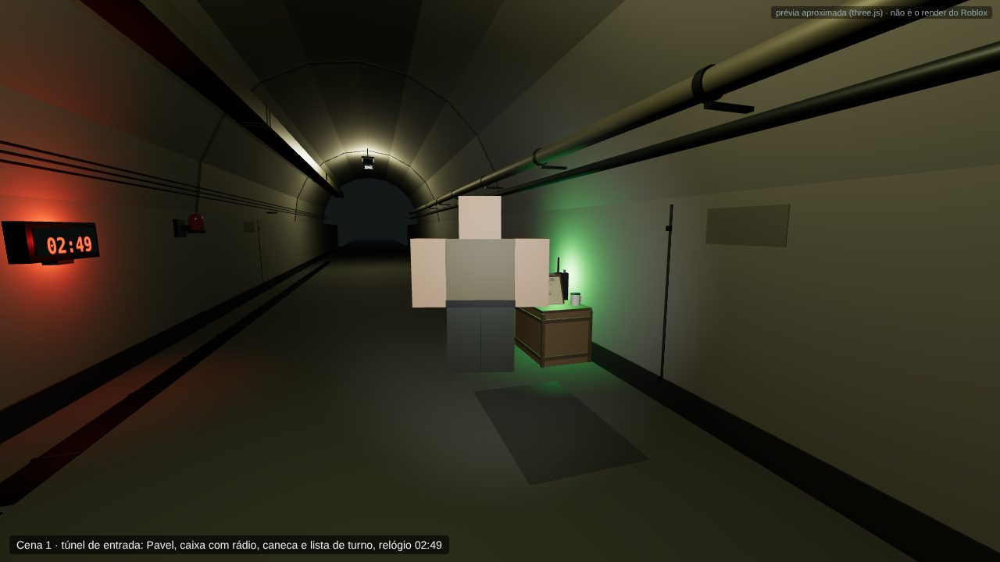
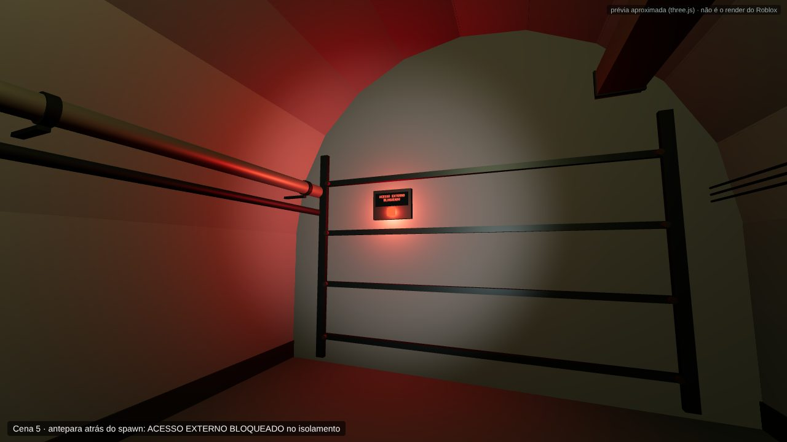
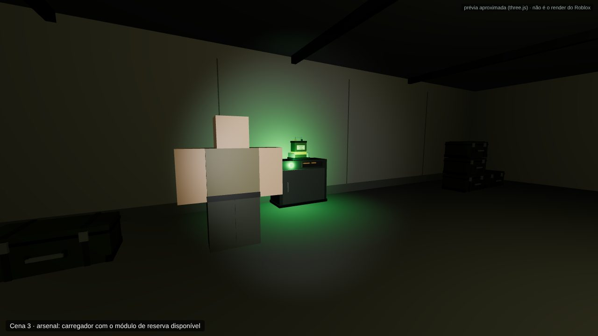
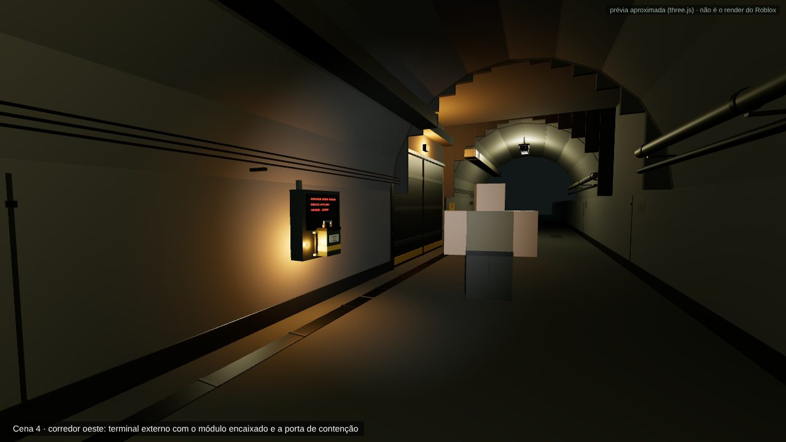
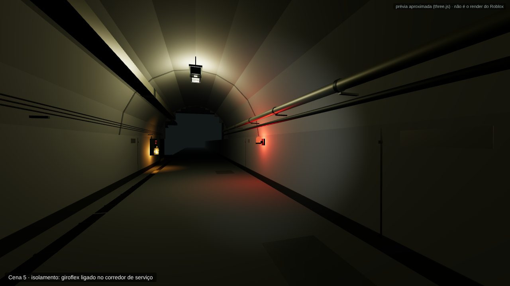
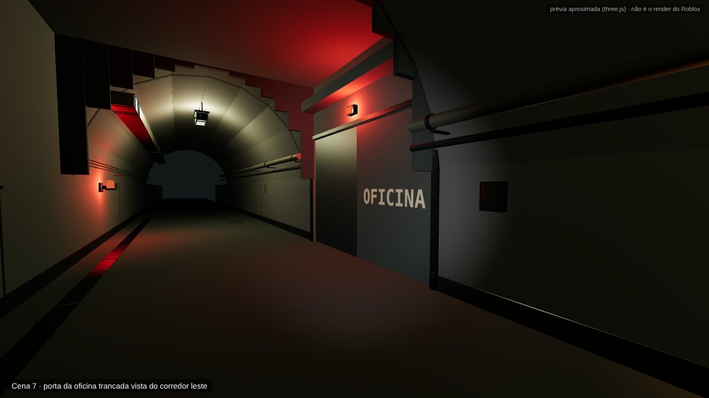
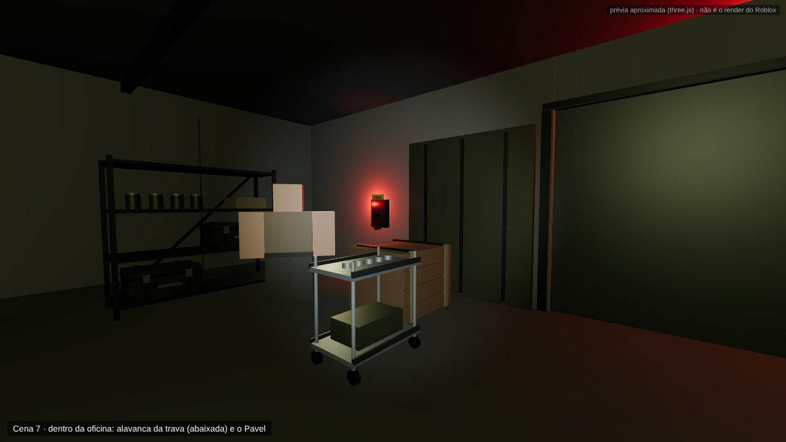
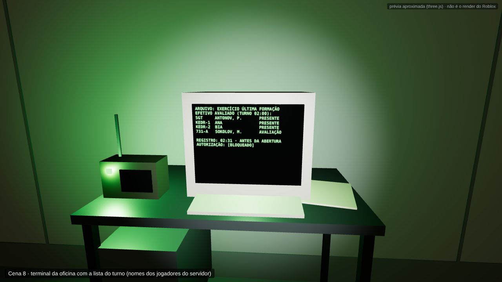

# Validação da Etapa 1

Tudo abaixo roda com `bash bastiao/ferramentas/testar_tudo.sh <place_original.rbxl>`.

| Teste | Arquivo | O que prova | Resultado |
|---|---|---|---|
| Sintaxe | `ferramentas/sintaxe.luau` | os 18 scripts compilam | 18 arquivos, 0 erro |
| Núcleo da história | `ferramentas/teste_historia.luau` | capítulo válido, textos existem, erro com caminho do campo, caminho completo até o final com as 6 flags, evento repetido não avança, fora de ordem é ignorado, efeitos com chave única, retrato isolado | 9/9 |
| Fluxo completo | `ferramentas/teste_fluxo.luau` | a abertura inteira com o cenário real e 2 jogadores falsos: rádio, módulo com portador, quem não carrega não encaixa, portador morre e o módulo volta, isolamento, porta espera o Pavel, trava só de dentro e com o Pavel dentro, checkpoint com lugar de renascer, lista com os nomes, fim; alcance 10 aceita / 10,1 recusa; anti-repetição; morto e quem saiu não interagem; cada legenda tem tempo de leitura | 13/13 |
| Cenário no place real | `ferramentas/teste_cenario.luau` | 133 peças novas sem atravessar as 8.572 do mapa; folhas abertas somem na parede; 20 pontos de apoio em parede/chão; 5 interações com lugar livre de ficar em pé ao alcance; zonas e renascer em chão livre; rota do Pavel livre (cápsula R6 a cada meio stud); mapa idêntico; só uma pasta nova | tudo OK |
| Instalador | `tests/test_instalador.py` | só scripts `Bastiao...`; recusa caminho fora do Bastião e filho antes do pai; manifesto adulterado é recusado; patch XML só acrescenta e é idempotente; script com mesmo nome e fonte desconhecida bloqueia; **place real binário: 9.004 instâncias originais idênticas e 18 scripts novos com a fonte exata (conferido pelo Lune)**; instalar pede `PUBLICAR ETAPA1` uma vez; confirmação errada não publica; teste reprovado bloqueia sem perguntar; resposta perdida → `resume` sem reenviar; envio pendente de outra etapa preservado; arquivo único funciona offline e acusa adulteração | 13/13 |
| Dentro do Roblox | `ferramentas/teste_nuvem.luau` (roda no `instalar`, numa versão Saved) | destino e hash de cada fonte; mapa, HUD e scripts Sector7 presentes; todos os módulos carregam; servidor da etapa sobe sem erro; abertura inteira com o cenário real no motor; interface montada; Pavel anda até o arsenal de verdade; nenhum erro "Bastiao" no log | roda na hora de instalar; se falhar, não publica |

Instalador: `bastiao/dist/BASTIAO_ETAPA1.py` (18 scripts, ~81 KB).

## Prévias (aproximadas, three.js com o mapa real e as peças novas; não é o render do Roblox)

Câmera na altura da bodycam, com a lanterna de peito, a neblina e as lâmpadas do mapa. O Pavel
aparece como blocos só na prévia (no jogo é o personagem R6 com o uniforme cáqui).










Para gerar de novo:

```
lune run bastiao/ferramentas/previa_cenario.luau <place.rbxl> <pasta>
node bastiao/ferramentas/previa/shot.js <pasta>/lote.json
```
