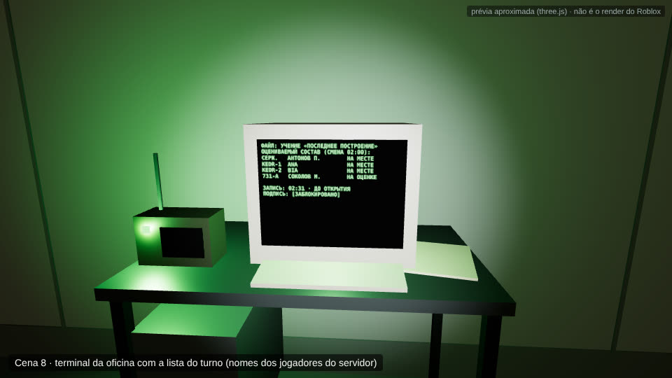

# Validação da Etapa 2

Tudo abaixo roda com `bash bastiao/ferramentas/testar_tudo.sh <place_original.rbxl>`.

| Teste | Arquivo | O que prova | Resultado |
|---|---|---|---|
| Sintaxe | `ferramentas/sintaxe.luau` | os 23 scripts compilam | 23 arquivos, 0 erro |
| Núcleo da história | `ferramentas/teste_historia.luau` | capítulo válido e caminho completo até o final | tudo OK |
| 3 línguas | `ferramentas/teste_idiomas.luau` | mesmas chaves e mesmos `%s` em PT/EN/RU; russo em cirílico; toda fala, som, objetivo, aviso e prompt usado tem texto, falante, canal e direção de voz; telas dos terminais cabem no visor em cada língua (com 6 nomes na lista); língua inicial pela conta Roblox | 5/5 |
| Fluxo completo | `ferramentas/teste_fluxo.luau` | a abertura inteira com 2 jogadores falsos; avisos vão como chave e o nome de quem carrega aparece nas 3 línguas; lista do turno desenhada em cada língua; falas nunca se sobrepõem (sem voz e com vozes longas de 7,5 s, que empurram o resto da cena); todo som/ruído tem efeito no cliente; sons do monstro com posição 3D; eco certo em sala, corredor e galpão | 15/15 |
| Cenário no place real | `ferramentas/teste_cenario.luau` | peças novas sem atravessar o mapa; mapa idêntico; só uma pasta nova | tudo OK |
| Instalador | `tests/test_instalador.py` | tudo da Etapa 1 e mais: com a Etapa 1 instalada, a Etapa 2 troca os scripts e um script da Etapa 1 mexido à mão **bloqueia**; o módulo de áudio gerado pode ser trocado, outro com o mesmo nome bloqueia; sons enviados uma vez só (recibo), chave sem permissão não trava nem insiste, som ainda processando termina na próxima sem reenviar, som recusado na moderação fica de fora, sem dono do jogo pula sem enviar | 22/22 |
| Dentro do Roblox | `ferramentas/teste_nuvem.luau` (roda no `instalar`, numa versão Saved) | tudo da Etapa 1 e mais: remotos de idioma, tabela de áudio válida, interface e telas montadas nas 3 línguas (tela da oficina em russo com a lista), som do cliente montado de verdade (grupos, eco, vozes, efeitos 3D, alarme) e, com os sons enviados, cada arquivo carrega e cabe nos trechos | roda na hora de instalar; se falhar, não publica |

Instalador: `bastiao/dist/BASTIAO_ETAPA2.py` (23 scripts e 2 arquivos de som, ~514 KB).

Sons desta entrega: `voz_pt.ogg` com 8 falas (35 s) e `efeitos.ogg` com os três toques ao longe.
Tratamento: corte de silêncio, volume igualado (cerca de -19 dB RMS nas vozes) e, por canal,
rádio (320-3400 Hz, saturação, chiado e estalos), fita velha (oscilação, chiado e 50 Hz) ou
alto-falante (corneta saturada; o eco é feito no jogo).

## Prévia: terminal da oficina em russo

Para gerar de novo: `lune run bastiao/ferramentas/previa_cenario.luau <place.rbxl> <saida> ru`
e `node bastiao/ferramentas/previa/shot.js <saida>/lote.json`.
